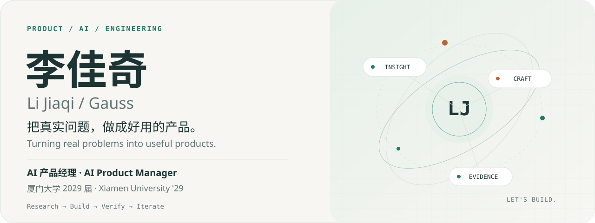
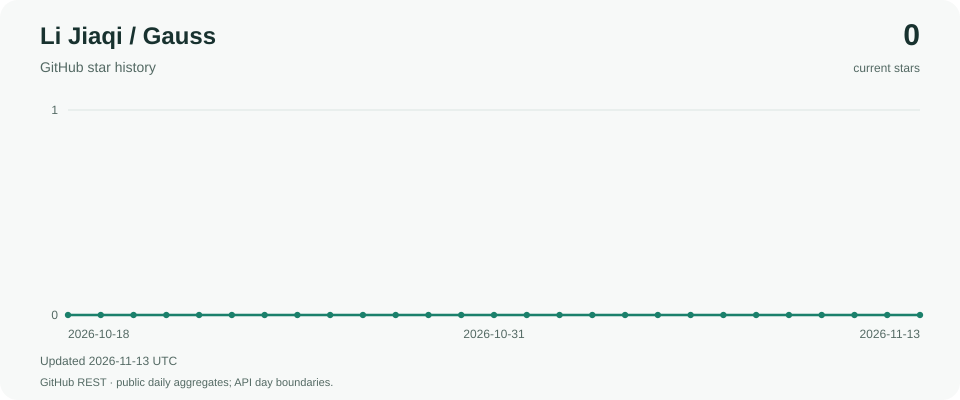

<picture>
  <source media="(max-width: 600px) and (prefers-color-scheme: dark)" srcset="assets/hero-mobile-dark.svg">
  <source media="(max-width: 600px)" srcset="assets/hero-mobile-light.svg">
  <source media="(prefers-color-scheme: dark)" srcset="assets/hero-dark.svg">
  
</picture>

<a href="#selected-work">Selected work</a> &nbsp; / &nbsp; <a href="#experience">Experience</a> &nbsp; / &nbsp; <a href="docs/project-atlas.en.md">Project guide</a> &nbsp; / &nbsp; <a href="README.md">中文 / English together</a>

# Hi, I'm Li Jiaqi.

**AI Product Manager · Open-source author · Product builder**

I connect user research, product design, AI-assisted development and verification. My work spans controllable agents, creative tools, local data and restaurant operations. I care about understanding a real problem, building something useful, and checking what actually works.

I'm an Advertising undergraduate at **Xiamen University, Class of 2029**. I previously worked on consumer AI products at **Alibaba · Fliggy**, founded **QGauss AI**, led digital product work for **Xiangcun Xiaozhao**, and started **MUNity**.

[Email](mailto:lijiaqi.mun@gmail.com) · [LinkedIn](https://www.linkedin.com/in/jiaqi-li-ai-product-manager/) · [Public repositories](https://github.com/lijiaqi-AI-Product-Manager?tab=repositories)

## Selected work

| Product | What it helps you do | Technology and entry point |
| :--- | :--- | :--- |
| **[job_radar](https://github.com/lijiaqi-AI-Product-Manager/job_radar)** | Search Chinese campus, internship and experienced-hire listings with source text, recruitment calendars and explicit unknown conditions. Download snapshots and query locally. | Python · SQLite · CLI / MCP / Skill. Install `jobsearchradar`, then run `jobradar update`. [Project guide](docs/project-atlas.en.md#job-radar) |
| **[QGauss AI](https://github.com/lijiaqi-AI-Product-Manager/QGauss-AI)** | Bring multi-model chat, image editing, video, voice, mind maps and applications into a self-hosted creative workspace with site operations tools. | Vue · NestJS · Prisma · SQLite. Guided setup from source; real providers and commerce need deployment configuration. [Project guide](docs/project-atlas.en.md#qgauss) |
| **[AgentCompare](https://github.com/lijiaqi-AI-Product-Manager/dsh-agent-compare)** | Generate two front-end implementations from one baseline, run both, compare before revealing models or strategies, then review and adopt the result. | TypeScript · React · Git worktree · DSH. Source/package installation; current scope is local root-level Vite projects. [Project guide](docs/project-atlas.en.md#agent-compare) |
| **[BugGPS](https://github.com/lijiaqi-AI-Product-Manager/dsh-bug-gps)** | Record a browser problem and the expected behavior, lock a reproducible failure, and replay the original scenario against the fix. | JavaScript · Playwright · Git · DSH. Local plugin installation and a built-in demo. [Project guide](docs/project-atlas.en.md#bug-gps) |
| **[skill-healthcheck](https://github.com/lijiaqi-AI-Product-Manager/skill-healthcheck)** | Find skills that silently stopped working. Combine host loading rules, upstream changes and session timelines to rank plausible explanations. | TypeScript · Git · Local evidence. Start with `npx skill-healthcheck`; source skills are not automatically updated. [Project guide](docs/project-atlas.en.md#skill-healthcheck) |
| **[unremember](https://github.com/lijiaqi-AI-Product-Manager/unremember)** | Selectively remove content from supported local agent files, inspect a plan, back up, apply, probe a fork and roll back when needed. | TypeScript · JSONL / Zstandard · SHA-256. Claude Code and DSH; local files only. [Project guide](docs/project-atlas.en.md#unremember) |

<strong>Watch AgentCompare: running previews, shared checks and adoption</strong>

This uses fixed candidates. Application execution, shared checks and adoption are real; waiting segments are edited. [Demo conditions](https://github.com/lijiaqi-AI-Product-Manager/dsh-agent-compare/blob/main/docs/demo.md).

**[Xiangcun Xiaozhao](docs/project-atlas.en.md#xiangcun)** brings QR ordering, kitchen updates, stored-value accounts, refunds, reconciliation, overnight closing reports and receipt printing into one restaurant workflow. React, Hono, SQLite and shared contracts connect the customer and owner interfaces.

**[AirStudy](docs/project-atlas.en.md#airstudy)** explores Android focus sessions through airports, routes, boarding passes and flight records. Local implementation uses Kotlin, View/XML, Room, Hilt, DataStore and Ktor. Its public repository currently provides a project entry and license, rather than the complete implementation or a downloadable product.

## How I work

**Research the problem → define behavior → build the product → verify and iterate.**

Across these projects, practical questions drive the engineering: a failed fetch must not mean a job disappeared; an unreadable skill must not mean it was deleted; a test passing on another server must not prove the current patch works. Retries, concurrent edits, interrupted operations and recovery belong in the product flow.

My toolkit includes competitive testing, PRDs, state machines, acceptance criteria, SOPs, roadmaps, Figma and Axure; multi-model APIs, agent workflows, prompting and context engineering; and TypeScript, JavaScript, Python, React, Vue, NestJS, Hono, SQLite and GitHub Actions.

## Experience

| Organization / project | Role and focus | Period |
| :--- | :--- | :--- |
| **Alibaba · Fliggy** | Consumer AI Product Manager intern; standardized evaluation, family travel agent requirements and interactive prototypes | Jul – Sep 2026 |
| **Xiangcun Xiaozhao** | Digital transformation PM, product and operations lead | Since Apr 2026 |
| **QGauss AI** | Founder; early multi-model product incubation, pricing and campus growth | Dec 2025 – Jul 2026 |
| **MUNity** | Founder and product R&D lead; Model UN AI agents and community platform | Since Sep 2026 |
| **Lenovo · Baiying** | Enterprise AI Product Manager internship; **accepted, not yet started** | Planned Jan – Feb 2027 |

At Fliggy, I designed a 22-question evaluation set and conducted approximately 330 dialogue rounds across six OTA assistants. Findings informed requirements, state machines, fallback behavior and an AI-assisted interactive prototype. [Detailed experience](docs/experience.en.md)

I have also served on academic teams and dais at national Model UN conferences, chaired more than 20 conferences, and founded the Shijiazhuang Model UN Association. Selected honors include Outstanding Camper at Peking University's School of International Studies summer program and a National Second Prize in the China division of IMMC.

**Languages:** English, IELTS Speaking 7.0; French, DELF B1; basic Russian, Japanese, Indonesian and Malay.

<strong>Upstream reading and attribution</strong>

My account also contains forks of [Lobe Chat](https://github.com/lijiaqi-AI-Product-Manager/lobe-chat), [CoAI](https://github.com/lijiaqi-AI-Product-Manager/coai) and [Blob Service](https://github.com/lijiaqi-AI-Product-Manager/blob-service). Their original development belongs to their upstream authors. [Separate reading notes](docs/project-atlas.en.md#upstream) preserve the distinction.

<!-- project-growth:start -->

## Project growth

Star history updates daily. Refresh dates use UTC; Star dates follow GitHub's aggregates.

<a href="https://github.com/lijiaqi-AI-Product-Manager/lijiaqi-AI-Product-Manager/stargazers">
<picture>
  <source media="(max-width: 600px) and (prefers-color-scheme: dark)" srcset="https://raw.githubusercontent.com/lijiaqi-AI-Product-Manager/lijiaqi-AI-Product-Manager/main/assets/growth/lijiaqi-AI-Product-Manager/stars-mobile-dark.svg">
  <source media="(max-width: 600px)" srcset="https://raw.githubusercontent.com/lijiaqi-AI-Product-Manager/lijiaqi-AI-Product-Manager/main/assets/growth/lijiaqi-AI-Product-Manager/stars-mobile-light.svg">
  <source media="(prefers-color-scheme: dark)" srcset="https://raw.githubusercontent.com/lijiaqi-AI-Product-Manager/lijiaqi-AI-Product-Manager/main/assets/growth/lijiaqi-AI-Product-Manager/stars-dark.svg">
  
</picture>
</a>

Download-request trends for individual projects appear in their own READMEs.

[Data sources and metric definitions](https://github.com/lijiaqi-AI-Product-Manager/lijiaqi-AI-Product-Manager/blob/main/docs/growth.md)

<!-- project-growth:end -->

---

**Let's make something useful.** [lijiaqi.mun@gmail.com](mailto:lijiaqi.mun@gmail.com) · [LinkedIn](https://www.linkedin.com/in/jiaqi-li-ai-product-manager/)
