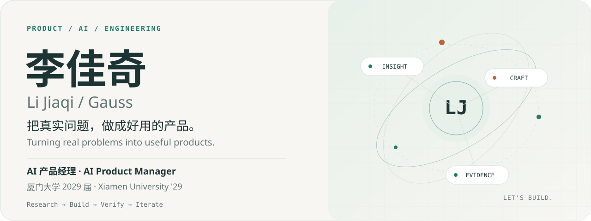
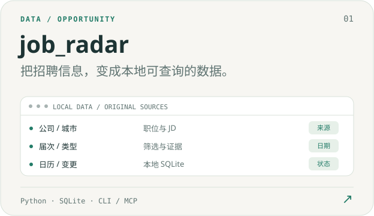
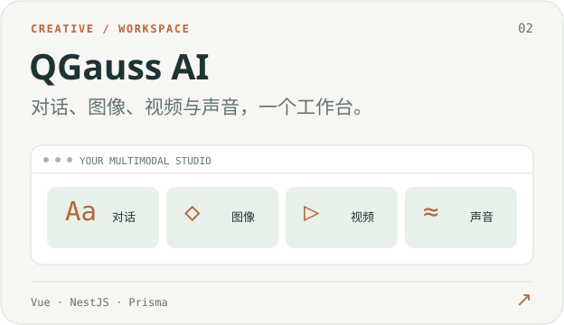
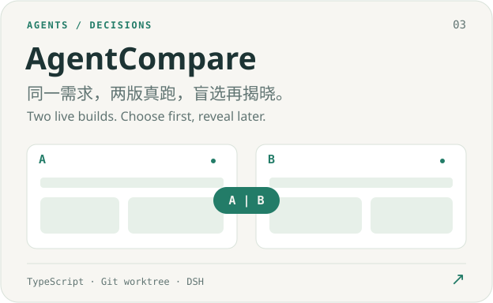
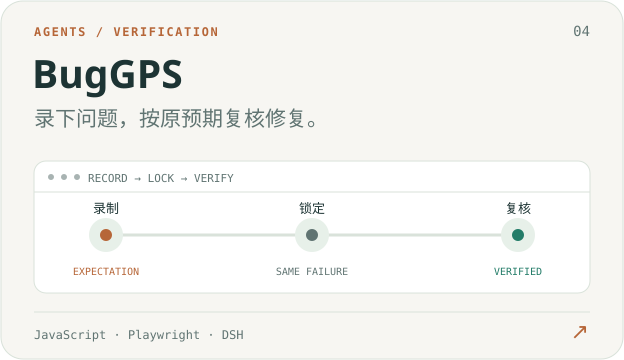
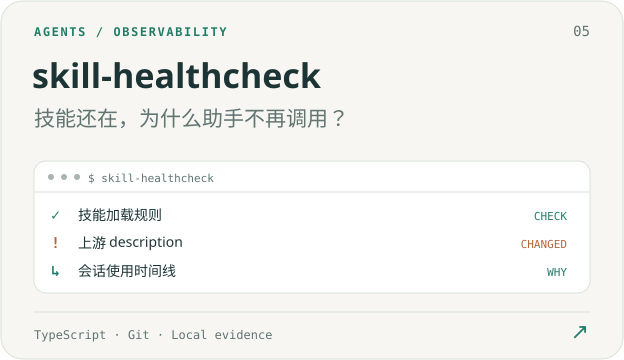
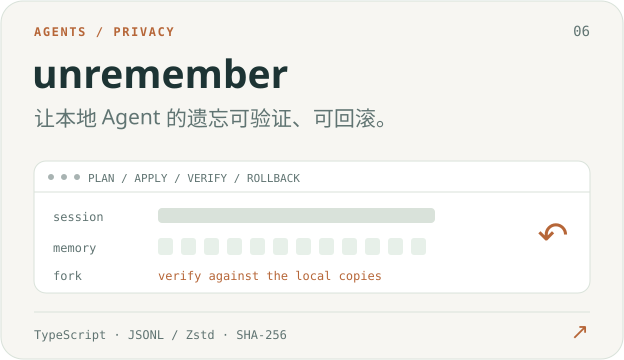
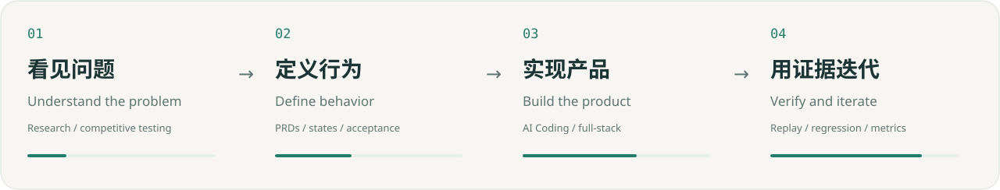
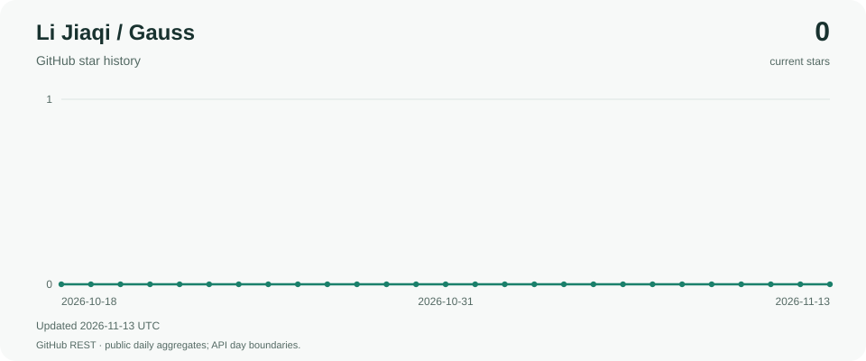

<picture>
  <source media="(max-width: 600px) and (prefers-color-scheme: dark)" srcset="assets/hero-mobile-dark.svg">
  <source media="(max-width: 600px)" srcset="assets/hero-mobile-light.svg">
  <source media="(prefers-color-scheme: dark)" srcset="assets/hero-dark.svg">
  
</picture>

  <a href="#projects">作品 Work</a> &nbsp; / &nbsp;
  <a href="#practice">实践 Practice</a> &nbsp; / &nbsp;
  <a href="docs/project-atlas.md">中文项目指南</a> &nbsp; / &nbsp;
  <a href="docs/project-atlas.en.md">Project guide EN</a> &nbsp; / &nbsp;
  <a href="#experience">经历 Experience</a> &nbsp; / &nbsp;
  <a href="README.en.md">English only</a>

# 李佳奇 · Li Jiaqi

**AI 产品经理 · 开源作者**  
**AI Product Manager · Open-source author · Product builder**

我把用户研究、产品设计、AI Coding 和验证串成一条工作流。关注 Agent 的可控性，也把 AI 带进创作、求职和门店经营：理解真实需求，做出能用的工具，再用证据持续改进。

I connect user research, product design, AI-assisted development and verification. My work spans controllable agents, creative tools, local job data and restaurant operations: understand a real need, build something useful, then improve it with evidence.

厦门大学广告学本科，**2029 届**。曾在 **阿里巴巴 · 飞猪** 从事 C 端 AI 产品工作，主导 **QGauss AI** 与 **湘村小灶数字化**，发起 **MUNity**。

I'm an Advertising undergraduate at **Xiamen University, Class of 2029**. I previously worked on consumer AI products at **Alibaba · Fliggy**, founded **QGauss AI**, led digital product work for **Xiangcun Xiaozhao**, and started **MUNity**.

[联系 / Email](mailto:lijiaqi.mun@gmail.com) · [LinkedIn](https://www.linkedin.com/in/jiaqi-li-ai-product-manager/) · [全部仓库 / Repositories](https://github.com/lijiaqi-AI-Product-Manager?tab=repositories)

 

## 代表作品 · Selected work

从可追溯的数据、可体验的创作工具，到可检验的 Agent 工作流。每个项目都从一个具体问题出发。

Traceable data, creative workspaces and verifiable agent workflows. Each project starts with a concrete problem.

<table>
<tr>
<td width="50%" valign="top">
<a href="https://github.com/lijiaqi-AI-Product-Manager/job_radar">
<picture><source media="(prefers-color-scheme: dark)" srcset="assets/job-radar-dark.svg"></picture>
</a>

中国校招、实习、社招与招聘日历。用 <strong>Python + SQLite</strong> 整理公开来源，CLI、MCP 与 Skill 共用查询规则，保留原文、出处和未知条件。

Search Chinese campus, internship and experienced-hire listings locally. <strong>Python + SQLite</strong> powers shared CLI, MCP and Skill queries, with original text, sources and unknown conditions preserved.

<a href="https://github.com/lijiaqi-AI-Product-Manager/job_radar">代码 / Code ↗</a> · <a href="docs/projects/job-radar.md">中文指南</a> · <a href="docs/project-atlas.en.md#job-radar">EN guide</a>

</td>
<td width="50%" valign="top">
<a href="https://github.com/lijiaqi-AI-Product-Manager/QGauss-AI">
<picture><source media="(prefers-color-scheme: dark)" srcset="assets/qgauss-dark.svg"></picture>
</a>

面向个人创作与小型站点运营的自托管平台。<strong>Vue + NestJS + Prisma</strong> 连接多模型对话、图像编辑、视频、声音、思维导图与运营后台。

A self-hosted workspace for individual creators and small AI sites. <strong>Vue + NestJS + Prisma</strong> connects multi-model chat, image editing, video, voice, mind maps and site operations.

<a href="https://github.com/lijiaqi-AI-Product-Manager/QGauss-AI">代码 / Code ↗</a> · <a href="docs/projects/qgauss.md">中文指南</a> · <a href="docs/project-atlas.en.md#qgauss">EN guide</a>

</td>
</tr>
<tr>
<td width="50%" valign="top">
<a href="https://github.com/lijiaqi-AI-Product-Manager/dsh-agent-compare">
<picture><source media="(prefers-color-scheme: dark)" srcset="assets/agent-compare-dark.svg"></picture>
</a>

把前端方案比较带进 DeepSeek Harness。<strong>独立 Git worktree、共同验收、真实预览、先选后揭晓</strong>，采用前审查改动，保留恢复与撤销记录。

Compare two front-end implementations inside DeepSeek Harness. <strong>Independent Git worktrees, shared checks and live previews</strong> support blind selection, reviewed adoption, recovery and undo.

<a href="https://github.com/lijiaqi-AI-Product-Manager/dsh-agent-compare">代码 / Code ↗</a> · <a href="docs/projects/agent-compare.md">中文指南</a> · <a href="docs/project-atlas.en.md#agent-compare">EN guide</a>

</td>
<td width="50%" valign="top">
<a href="https://github.com/lijiaqi-AI-Product-Manager/dsh-bug-gps">
<picture><source media="(prefers-color-scheme: dark)" srcset="assets/bug-gps-dark.svg"></picture>
</a>

把“我操作时出了问题”变成可重复检查。<strong>JavaScript + Playwright</strong> 录下操作和预期，锁定稳定失败，再用当前代码启动应用、重放复核。

Turn a browser problem into a repeatable check. <strong>JavaScript + Playwright</strong> records actions and expectations, locks a reproducible failure, then starts the app from current code and replays the original scenario.

<a href="https://github.com/lijiaqi-AI-Product-Manager/dsh-bug-gps">代码 / Code ↗</a> · <a href="docs/projects/bug-gps.md">中文指南</a> · <a href="docs/project-atlas.en.md#bug-gps">EN guide</a>

</td>
</tr>
<tr>
<td width="50%" valign="top">
<a href="https://github.com/lijiaqi-AI-Product-Manager/skill-healthcheck">
<picture><source media="(prefers-color-scheme: dark)" srcset="assets/skill-healthcheck-dark.svg"></picture>
</a>

找出“文件还在，模型却不再调用”的技能。结合<strong>宿主加载规则、上游 Git 变化和会话时间线</strong>，为 Claude Code、Codex 与 DSH 提供体检与排查线索。

Find skills that still exist on disk but are no longer called. Combine <strong>host loading rules, upstream Git changes and session timelines</strong> to inspect Claude Code, Codex and DSH setups.

<a href="https://github.com/lijiaqi-AI-Product-Manager/skill-healthcheck">代码 / Code ↗</a> · <a href="docs/projects/skill-healthcheck.md">中文指南</a> · <a href="docs/project-atlas.en.md#skill-healthcheck">EN guide</a>

</td>
<td width="50%" valign="top">
<a href="https://github.com/lijiaqi-AI-Product-Manager/unremember">
<picture><source media="(prefers-color-scheme: dark)" srcset="assets/unremember-dark.svg"></picture>
</a>

给本地编码 Agent 做定向遗忘。清理会话及相关副本，先计划、再备份与执行，使用<strong>哈希核验、原子写入、隔离追问与回滚</strong>保护其余上下文。

Selectively remove content from supported local agent files. Plan, inspect, back up and apply, with <strong>hash checks, atomic writes, fork-based probes and rollback</strong> to protect the remaining context.

<a href="https://github.com/lijiaqi-AI-Product-Manager/unremember">代码 / Code ↗</a> · <a href="docs/projects/unremember.md">中文指南</a> · <a href="docs/project-atlas.en.md#unremember">EN guide</a>

</td>
</tr>
</table>

<strong>真实运行演示 / Watch AgentCompare: live previews, checks and adoption</strong>

 

固定候选示例，应用运行、共同验收与采用实际执行；等待段已剪辑。[演示条件与结果](https://github.com/lijiaqi-AI-Product-Manager/dsh-agent-compare/blob/main/docs/demo.md)。

Fixed-candidate demonstration: application execution, shared checks and adoption are real; waiting segments are edited. The interface is Chinese; the sequence shows two running previews, common checks, selection and reviewed adoption. [Demo conditions](https://github.com/lijiaqi-AI-Product-Manager/dsh-agent-compare/blob/main/docs/demo.md).

 

## 从问题到交付 · From insight to delivery

<picture>
  <source media="(max-width: 600px) and (prefers-color-scheme: dark)" srcset="assets/process-mobile-dark.svg">
  <source media="(max-width: 600px)" srcset="assets/process-mobile-light.svg">
  <source media="(prefers-color-scheme: dark)" srcset="assets/process-dark.svg">
  
</picture>

**飞猪 · 让 AI 旅行助手的体验可比较。** 在实习中构建 22 道统一题库，对 6 家 OTA 平台开展约 330 轮对话评测；把多轮约束、长辈交互和订单感知等发现，转成家庭出行智能体的 PRD、状态机、失败降级与可交互原型。[经历与方法 →](docs/experience.md)

**Fliggy · Making AI travel assistants comparable.** During my internship, I designed 22 standardized questions and conducted approximately 330 dialogue rounds across six OTA assistants. Findings informed a family travel agent's requirements, state machines, fallbacks and interactive prototype. [Experience →](docs/experience.en.md)

**湘村小灶 · 把产品做到门店的日常里。** 从扫码点单、后厨实时收单，做到会员储值账本、退款对账、跨夜日结与小票打印。React、Hono、SQLite 与店铺配置共同支撑顾客端和老板端；加菜、重试和跨日统计都有明确规则。[项目与使用路径 →](docs/projects/xiangcun.md)

**Xiangcun Xiaozhao · Products for everyday restaurant operations.** QR ordering, kitchen updates, stored-value ledgers, refunds, reconciliation, overnight closing reports and printing. React, Hono, SQLite and brand configuration connect customer and owner workflows. [Project guide →](docs/project-atlas.en.md#xiangcun)

**AirStudy · 把专注时间变成一段飞行。** Android 专注体验，围绕机场、路线、计时会话、登机牌与飞行记录组织交互。使用 Kotlin、View/XML、Room、Hilt 与 Ktor，重点处理后台生命周期、状态恢复和账号边界。[项目概览与公开范围 →](docs/projects/airstudy.md)

**AirStudy · Turn focus time into a flight.** An Android focus experience built around airports, routes, timed sessions, boarding passes and flight records. Local implementation uses Kotlin, View/XML, Room, Hilt and Ktor, with attention to lifecycle, recovery and account boundaries. [Overview and public scope →](docs/project-atlas.en.md#airstudy)

 

## 我带来的能力 · What I bring

| 方向 / Area | 工作方式与工具 / Methods and tools |
| :--- | :--- |
| **产品研究与定义** Product research | 竞品实测、需求拆解、PRD、状态机、验收标准、SOP、Roadmap、Figma / Axure Competitive testing, problem framing, requirements, state machines and acceptance criteria |
| **AI 应用与工作流** AI applications | 多模型 API、Agent 设计、提示词与上下文工程、Coze / GLM、MCP / Skill Multi-model APIs, agent design, prompting, context engineering and workflow integration |
| **实现与交付** Implementation | TypeScript / JavaScript、Python、React / Vue、NestJS / Hono、SQLite / Prisma、GitHub Actions |
| **验证与迭代** Verification | 浏览器重放、共同验收、来源追溯、回归、事务与幂等、失败恢复、业务复盘 Browser replay, shared checks, provenance, regression, transactions, idempotency and recovery |

## 经历与视野 · Experience and perspective

| 经历 / Organization | 方向 / Role | 时间 / Period |
| :--- | :--- | :--- |
| **阿里巴巴 · 飞猪** Alibaba · Fliggy | C 端 AI 产品经理实习 Consumer AI Product Manager intern | Jul–Sep 2026 |
| **湘村小灶** Xiangcun Xiaozhao | 数字化转型 / 产品与运营负责人 Digital transformation PM; product and operations lead | 2026.04 起 Since Apr 2026 |
| **QGauss AI** | 创始人 / 负责人，早期平台孵化 Founder; early multi-model platform incubation | Dec 2025–Jul 2026 |
| **MUNity** | 创始人 / 首席产品研发负责人 Founder and product R&D lead; Model UN AI agents and community | 2026.09 起 Since Sep 2026 |
| **联想 · 百应** Lenovo · Baiying | B 端 AI 产品经理实习，**已录取、待实习** Enterprise AI Product Manager internship; **accepted, not yet started** | 计划 / Planned Jan–Feb 2027 |

**研究与组织之外，也持续面向真实的人。** 参与北京大学全国模联大会、中国日报社全国模联大会学术与主席团工作，担任 20 余场模联活动主席团负责人或主席；创办石家庄市模联协会并任首任秘书长。

Alongside product work, I have served on academic teams and dais at Peking University and China Daily national Model UN conferences, chaired more than 20 conferences, and founded the Shijiazhuang Model UN Association as its first Secretary-General.

北京大学国际关系学院暑期课堂优秀营员 · IMMC 国际数学建模挑战赛中华赛区全国二等奖。英语雅思口语 **7.0**，法语 **DELF B1**；俄语、日语、印尼语、马来语基础沟通。

Selected honors: Outstanding Camper at Peking University's School of International Studies summer program; National Second Prize in the China division of IMMC. **Languages:** English, IELTS Speaking **7.0**; French, **DELF B1**; basic Russian, Japanese, Indonesian and Malay.

[完整经历 / 中文](docs/experience.md) · [Detailed experience / English](docs/experience.en.md)

<strong>生态阅读与技术参考 / Upstream reading and attribution</strong>

我也保留了 [Lobe Chat](https://github.com/lijiaqi-AI-Product-Manager/lobe-chat)、[CoAI](https://github.com/lijiaqi-AI-Product-Manager/coai) 和 [Blob Service](https://github.com/lijiaqi-AI-Product-Manager/blob-service) 的上游 Fork，阅读多模型工作台、渠道与计费、文件解析的产品和工程设计。它们的原创工作归上游作者；[逐仓库阅读记录](docs/projects/ecosystem.md) 单独保留来源。

My account also contains forks of Lobe Chat, CoAI and Blob Service, used to study multi-model workspaces, routing, billing and file processing. Their original development belongs to their upstream authors. [English reading notes](docs/project-atlas.en.md#upstream) preserve this distinction.

 

<!-- project-growth:start -->

## 项目增长 · Project growth

Star 历史每天自动更新。更新日期采用 UTC，Star 日期沿用 GitHub 聚合口径。

Star history updates daily. Refresh dates use UTC; Star dates follow GitHub's aggregates.

<a href="https://github.com/lijiaqi-AI-Product-Manager/lijiaqi-AI-Product-Manager/stargazers">
<picture>
  <source media="(max-width: 600px) and (prefers-color-scheme: dark)" srcset="https://raw.githubusercontent.com/lijiaqi-AI-Product-Manager/lijiaqi-AI-Product-Manager/main/assets/growth/lijiaqi-AI-Product-Manager/stars-mobile-dark.svg">
  <source media="(max-width: 600px)" srcset="https://raw.githubusercontent.com/lijiaqi-AI-Product-Manager/lijiaqi-AI-Product-Manager/main/assets/growth/lijiaqi-AI-Product-Manager/stars-mobile-light.svg">
  <source media="(prefers-color-scheme: dark)" srcset="https://raw.githubusercontent.com/lijiaqi-AI-Product-Manager/lijiaqi-AI-Product-Manager/main/assets/growth/lijiaqi-AI-Product-Manager/stars-dark.svg">
  
</picture>
</a>

各项目的下载请求趋势见对应项目 README。

Download-request trends for individual projects appear in their own READMEs.

[数据来源与统计口径 / Data sources and metric definitions](https://github.com/lijiaqi-AI-Product-Manager/lijiaqi-AI-Product-Manager/blob/main/docs/growth.md)

<!-- project-growth:end -->

 

<a href="mailto:lijiaqi.mun@gmail.com">
<picture>
  <source media="(prefers-color-scheme: dark)" srcset="assets/footer-dark.svg">
  
</picture>
</a>

<a href="mailto:lijiaqi.mun@gmail.com">lijiaqi.mun@gmail.com</a> &nbsp; · &nbsp; <a href="https://www.linkedin.com/in/jiaqi-li-ai-product-manager/">LinkedIn</a> &nbsp; · &nbsp; <a href="docs/project-atlas.md">中文项目档案</a> &nbsp; · &nbsp; <a href="docs/project-atlas.en.md">Project guide EN</a>

